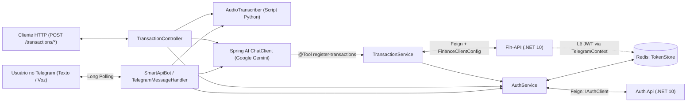
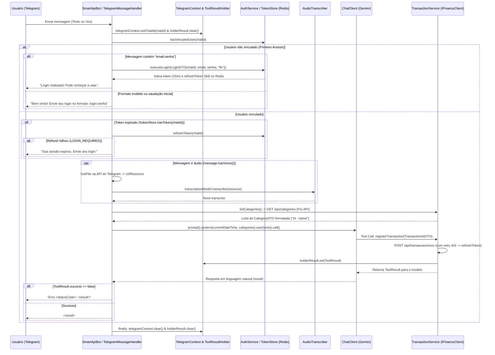
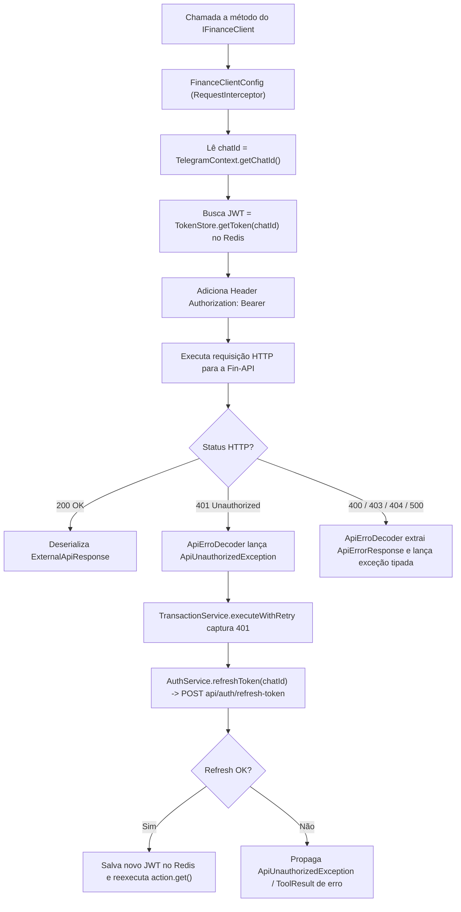

# Mapeamento de Fluxos e Arquitetura — SmartApi (`docs/flows.md`)

Este documento detalha os fluxos reais implementados no **SmartApi**, cobrindo o Bot do Telegram, os endpoints REST, a integração com o modelo Google Gemini via Spring AI (Tool Calling), o gerenciamento de sessão no Redis e a comunicação via OpenFeign com `Auth.Api` e `Fin-API`.

---

## 1. Visão Arquitetural



---

## 2. Fluxo Conversacional via Bot do Telegram

**Entry point:** `SmartApiBot.consume(List<Update>)` -> `TelegramMessageHandler.handle(Message)`



---

## 3. Fluxo via API REST (`TransactionController`)

### 3.1 Login e Vínculo de Sessão (`POST /transactions/login`)
1. Recebe `LoginDTO` (`{ chatId, email, password, system }`).
2. `AuthService.executeLogin(login)` chama `IAuthClient.executeLogin` (`POST api/auth/login` na `Auth.Api`).
3. Extrai `accessToken` e `refreshToken` do envelope `ExternalApiResponse<LoginResponse>`.
4. Salva no Redis via `TokenStore`:
   - `token:<chatId>` (TTL: 15 minutos)
   - `refreshToken:<chatId>` (TTL: 8 dias)
5. Retorna `200 OK` com `InternalApiResponse`:
   ```json
   {
     "success": true,
     "data": {
       "token": "<jwt>"
     }
   }
   ```

### 3.2 Registro de Transação por Áudio com IA (`POST /transactions/ai`)
1. Recebe `multipart/form-data` com `file` (`MultipartFile`) e `chatId` (`@RequestParam Long`).
2. Consulta categorias disponíveis na `Fin-API` via `transactionService.listCategories()`.
3. Converte o arquivo de áudio em texto via `transcriptionModel.transcribe(file.getResource())` (`AudioTranscriber`).
4. Invoca o `ChatClient` injetando `currentDateTime` e `categories` no template `classpath:/prompts/system.st`.
5. O modelo Google Gemini extrai os dados da fala seguindo as regras do prompt (datas relativas como "ontem", "hoje", categoria mais adequada, parcelamento/recorrência) e aciona a tool `register-transactions`.
6. Verifica o `ToolResultHolder`:
   - **Se `!holder.get().success()`:** retorna o `statusCode` original da falha com `ErrorResponse` (`{ statusCode, message, errors }`).
   - **Se `holder.get().success()`:** retorna `201 Created` (`Location: /transactions`) com `InternalAiApiResponse`:
     ```json
     {
       "success": true,
       "aiResponse": "Resposta amigável gerada pelo Gemini",
       "data": "Transação registrada com sucesso! ID: <id>"
     }
     ```

---

## 4. Fluxo de Autenticação, Propagação de Token e Retry (`OpenFeign`)



---

## 5. Regras de Extração da IA (`prompts/system.st`)

O System Prompt (`src/main/resources/prompts/system.st`) instrui o modelo a seguir regras determinísticas antes de acionar `register-transactions`:

- **Data da Transação (`dataMovimentacao`):**
  - Se omitida ou `"hoje"` -> usa `{currentDateTime}`.
  - `"ontem"` -> `{currentDateTime} - 1 dia`.
  - `"anteontem"` -> `{currentDateTime} - 2 dias`.
  - `"semana passada"` -> calcula data correspondente a partir de `{currentDateTime}`.
  - Formato obrigatório: `yyyy-MM-dd'T'HH:mm`.
- **Categoria (`categoriaId`):**
  - Deve escolher exclusivamente um dos IDs fornecidos em `{categories}` (`id - name`).
- **Recorrência e Parcelamento (`isRecurring`, `parcelas`, `parcelaAtual`):**
  - Se `isRecurring == false` -> `parcelas = null`, `parcelaAtual = null`, `recorrenciaType = null`, `recorrenciaEndDate = null` (nunca enviar `1/1` para transações únicas).
  - Se `isRecurring == true` e parcelado -> extrai total de `parcelas` e `parcelaAtual`.

---

## 6. Mapa Consolidado de Endpoints e Tools

### Endpoints Expostos pelo SmartApi
| Método & Rota | Consumo | Descrição |
| :--- | :--- | :--- |
| `POST /transactions/login` | `application/json` (`LoginDTO`) | Autentica usuário na `Auth.Api` e vincula tokens ao `chatId` no Redis. |
| `POST /transactions/ai` | `multipart/form-data` (`file`, `chatId`) | Transcreve áudio, processa intenção financeira via Gemini e registra transação na `Fin-API`. |
| `GET /actuator/health` | - | Health check do Spring Boot Actuator (usado no deploy Render/Docker). |
| `GET /swagger-ui/index.html` | - | Documentação interativa OpenAPI / Swagger. |

### Tools Spring AI Registradas (`@Tool`)
| Nome da Tool | Classe / Método | Status Atual |
| :--- | :--- | :--- |
| `register-transactions` | `TransactionService.registerTransaction(TransactionAiDTO)` | **Ativa** — converte para `TransactionRequest` e chama `POST api/transacoes/novo` na `Fin-API`. |
| `list-transactions-by-period` | `TransactionService.listTransactionsByPeriod()` | **Pendente** — lança `UnsupportedOperationException("Método não implementado")`. |
| `execute-login` | `AuthService.executeLogin(LoginDTO)` | **Ativa** — anotada com `@Tool`, embora seja chamada diretamente pelo controller e pelo handler do Telegram. |
