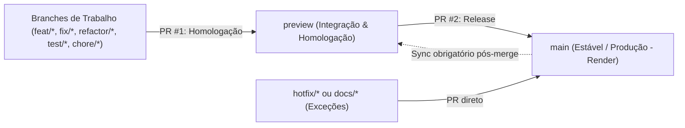

# Estratégia Git: Branches, Commits e Pull Requests — SmartApi (`docs/git-workflow.md`)

Este documento define o fluxo de versionamento do **SmartApi**, alinhado ao ecossistema (`Auth.Api`, `Fin-API` e `FinControl`) e otimizado para colaboração humana e **fluxo AI-First** (commits semânticos, rastreabilidade de prompts/tools e Pull Requests padronizados).

---

## 1. Estratégia de Branches

O repositório adota o fluxo com **branch intermediária (`preview`)** para validar integrações com `Auth.Api`, `Fin-API`, Redis, Telegram e Google Gemini antes da promoção para `main`:



### Regras do Fluxo
1. **`main` (Produção / Estável):**
   - Reflete a versão estável em produção (deploy automatizado via `Dockerfile` no Render).
   - **Evitar** commits diretos de código funcional na `main`.
   - Recebe entregas validadas a partir da `preview` via Pull Request (ou exceções de `hotfix/*` e `docs/*`).
2. **`preview` (Branch Intermediária de Homologação):**
   - Concentra novas tools de IA, ajustes de prompt (`system.st`), mudanças no bot do Telegram e contratos OpenFeign antes de irem para produção.
   - Caso a branch `preview` ainda não exista no remoto ao iniciar um novo ciclo, crie-a a partir da `main` atualizada (`git checkout -b preview && git push -u origin preview`).
3. **Branches de Trabalho (`<tipo>/<descricao-kebab-case>`):**
   - Devem ser curtas, focadas em uma única entrega e criadas a partir de `preview`:
     - `feat/` — Nova tool de IA, comando do bot ou endpoint (ex.: `feat/tool-listar-transacoes-periodo`)
     - `fix/` — Correção de bug (ex.: `fix/propagacao-chat-id-list-categories`)
     - `refactor/` — Melhoria interna sem alterar contrato externo (ex.: `refactor/extracao-handler-telegram`)
     - `docs/` — Documentação (`CONTEXT.md`, `README.md`, `docs/*`)
     - `test/` — Testes unitários ou de integração (`*IT.java`)
     - `chore/` — Dependências Maven (`pom.xml`), `Dockerfile`, `entrypoint.sh`, `compose.yml`
     - `hotfix/` — Correção crítica urgente em produção

### Ciclo de Vida Recomendado
1. Atualizar a branch base:
   ```powershell
   git checkout preview # ou main caso esteja criando a preview
   git pull
   ```
2. Criar a branch de trabalho:
   ```powershell
   git checkout -b feat/nome-da-funcionalidade
   ```
3. Desenvolver e validar a compilação (`.\mvnw.cmd clean compile`).
4. Abrir **PR da branch de trabalho -> `preview`**.
5. Após validação integrada (Telegram Bot / Swagger / Fin-API), abrir **PR de `preview` -> `main`**.
6. Remover a branch de trabalho após o merge.

---

## 2. Convenção de Mensagens de Commit

Adotamos **Conventional Commits** em português, no modo imperativo ou gerúndio consistente, sem ponto final no título:

```text
<tipo>(<escopo>): <descrição curta e objetiva>

[corpo opcional: explica o PORQUÊ da mudança, ajustes no system.st ou contratos Feign]

[rodapé opcional: Breaking changes, Refs #issue]
```

> **Evolução do padrão:** O histórico anterior utilizava `<tipo>/ <mensagem>` (ex.: `feat/ adicionando actuator para health no render`, `refactor/ adicionando log detalhado...`). Migrar para `<tipo>(<escopo>): <mensagem>` mantém a simplicidade e padroniza este repositório com `auth` e `fin`.

### Tipos Permitidos
| Tipo | Quando usar |
| :--- | :--- |
| `feat` | Nova tool (`@Tool`), fluxo no Telegram, endpoint REST ou integração |
| `fix` | Correção de bug (ex.: `ThreadLocal`, Redis TTL, contrato Feign) |
| `hotfix` | Correção crítica urgente em produção |
| `refactor` | Reestruturação interna de código sem alterar comportamento externo |
| `docs` | Atualização de `CONTEXT.md`, `README.md`, `docs/*` |
| `test` | Adição ou ajuste de testes em `src/test/java` |
| `chore` | `pom.xml`, `Dockerfile`, `entrypoint.sh`, `application.yml` |
| `perf` | Otimização de consumo de tokens/prompts, cache Redis ou chamadas HTTP |

### Escopos Sugeridos
`telegram`, `ai`, `prompt`, `tools`, `auth`, `feign`, `redis`, `audio`, `api`, `docker`, `docs`, `tests`

### Exemplos
```text
feat(tools): implementa tool list-transactions-by-period no TransactionService
fix(telegram): usa chatId do TelegramContext em listCategories em vez de 1L fixo
fix(auth): considera refreshToken no Redis ao validar hasVinculedUser
refactor(prompt): melhora instrucoes de parcelamento no system.st
docs(context): cria CONTEXT.md, mapeamento de fluxos e guia de branches
chore(docker): ajusta inicializacao do redis no entrypoint.sh
```

---

## 3. Padrão de Pull Requests (PR)

- **Título da PR de Trabalho (`feat/*` -> `preview`):** Segue o formato do commit principal (ex.: `fix(telegram): corrige propagação do chatId na listagem de categorias`).
- **Título da PR de Release (`preview` -> `main`):** `release: consolida entregas da preview para main (<resumo>)`.
- **Descrição:** Utilize o template oficial em [`.github/pull_request_template.md`](../.github/pull_request_template.md), informando impactos em prompts, tools do Spring AI, variáveis de ambiente (`GENAI_KEY`, `FINANCE_URL`, `AUTH_URL`, `TELEGRAM_BOT_TOKEN`) e contratos com `Auth.Api` e `Fin-API`.
